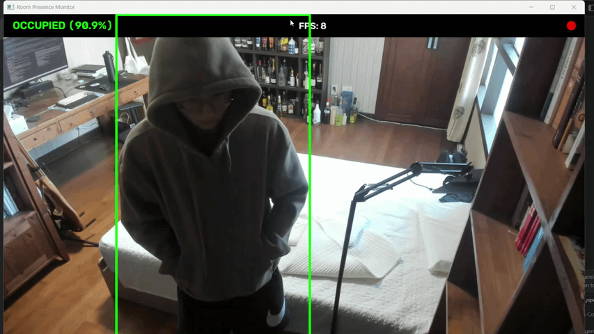

# Room Presence Detection via Custom Dual-Head YOLO

An end-to-end custom PyTorch implementation of a lightweight, Dual-Head YOLO (You Only Look Once) architecture designed for real-time room presence detection and bounding box tracking using a fixed webcam setup.

## Detection Example

*Live inference from the Dual-Head SimpleYOLO model rendering the bounding box and confidence HUD.*

## Project Overview

Unlike generic pre-trained detectors that attempt to generalize across thousands of varied environments, this model is explicitly optimized as a spatial-aware presence monitor for a single, fixed physical space. By training a customized dual-head neural network without dropout, the system achieves near-instant background interaction learning and pixel-precise coordinate regression.

### Key Performance Metrics

* **Custom Dual-Head SimpleYOLO:** 97.77% Accuracy | 0.5069 Avg IoU
* **Custom MobileNetYOLO (Transfer Learning):** 98.05% Accuracy | 0.7773 Avg IoU
* **SOTA YOLO26 (Zero-Shot):** 75.77% Accuracy | 0.8853 Avg IoU
* **SOTA YOLOv12 (Zero-Shot):** 74.09% Accuracy | 0.8788 Avg IoU

*Inference Speed: ~60+ FPS on NVIDIA RTX GPUs (1920x1080 native frame scaling)*

## Architecture & Loss Design

```text
                     +-----------------------+
                     |  Input Frame (256x256)|
                     +-----------+-----------+
                                 |
                     +-----------v-----------+
                     | 3x Conv2d + LeakyReLU |
                     |     + MaxPool2d       |
                     |    + BatchNorm2d      |
                     +-----------+-----------+
                                 |
                     +-----------v-----------+
                     |  FC Layers (512 -> 256)|
                     +-----------+-----------+
                                 |
                 +---------------+---------------+
                 |                               |
     +-----------v-----------+       +-----------v-----------+
     |   Head 1: Confidence  |       |   Head 2: Box Coords  |
     |   Linear(256 -> 1)    |       |   Linear(256 -> 4)    |
     |   Logits output       |       |   Sigmoid [0, 1]      |
     +-----------+-----------+       +-----------+-----------+
                 |                               |
                 +---------------+---------------+
                                 |
                     +-----------v-----------+
                     | Output Tensor (1x5)   |
                     | [conf, x, y, w, h]    |
                     +-----------------------+
```

### 1. Dual-Head Separation

To prevent gradient interference between presence classification and spatial coordinate regression, the final layer splits into two distinct linear heads:

* **Confidence Head (`head_conf`):** Predicts raw logit scores for person presence (`is_person`).
* **Box Coordinate Head (`head_box`):** Predicts bounding box center and scale `[x_center, y_center, width, height]`. A `Sigmoid` activation function strictly clamps spatial outputs between `0.0` and `1.0` (percentages of image dimensions).

### 2. Tailored Loss Function (`YOLOLoss`)

* **Binary Cross-Entropy (`BCEWithLogitsLoss`):** Weighted with `pos_weight=5.0` to penalize false negatives (missed person detections) 5 times more severely than false positives, neutralizing empty-room class imbalance.
* **Masked Mean Squared Error (`MSELoss`):** Coordinate loss is multiplied by the ground-truth target mask (`target_conf`), completely suppressing coordinate penalties when the room is vacant. Active bounding box errors are multiplied by `5.0` to force spatial accuracy.

### 3. Fixed-Camera Optimization & Overfitting

* **Intentional Overfitting (Removal of `Dropout`):** Regularization layers like Dropout force a model to generalize. By omitting dropout, this model is intentionally allowed to overfit to the exact geometry, furniture placement, lighting conditions, and specific objects of the targeted room. It effectively memorizes the background to perform hyper-accurate background subtraction.
* **Environment Specificity:** Because the model acts as a highly specialized memorization tool for one specific room, **it will not generalize to other rooms.** To reproduce this detection quality in a different area or from a different camera angle, a new training dataset must be gathered and the model must be retrained from scratch.

### 4. The MobileNet Transfer Learning Track

To benchmark custom architectures against generalized feature extraction, a secondary `MobileNetYOLO` class was introduced. 
* **Backbone:** The pre-trained `MobileNetV2` feature extractor was utilized and mostly frozen, preventing the model from memorizing specific room furniture and forcing it to rely on generalized human geometry. The final four convolutional blocks (Layers 15-18) were unfrozen to allow for edge-detection fine-tuning specific to the room environment.
* **Head Mapping:** A flattened split-head architecture maps the 8x8 spatial grid output to the confidence and bounding box coordinates, trained using Generalized Intersection over Union (GIoU) loss to mathematically enforce shape alignment and overlap.
* **Performance Delta:** While State-of-the-Art models (YOLO26, YOLOv12) achieved superior bounding box tightness (0.88+ IoU), their zero-shot implementation resulted in lower classification accuracy (~75%) due to predicting hundreds of unmasked background COCO classes. The fine-tuned MobileNet track delivered the optimal balance: 98.05% Accuracy (eliminating background false positives) and 0.7773 Avg IoU.

## Live Visual HUD & State Machine

The deployment script (`scripts/live_pipeline.py`) renders a real-time Heads-Up Display (HUD) over the native 1080p camera feed.

* **Debounce Buffer State Machine:** Maintained via a 10-frame running counter (`BUFFER_MAX = 10`). A room is declared `OCCUPIED` only when presence is continuously detected across consecutive frames, eliminating transient false triggers.
* **Coordinate Denormalization:** Predictions in normalized space $[0.0, 1.0]$ are scaled by native dimensions (`1920` width, `1080` height) to draw non-distorted bounding boxes.

## Repository Structure

```text
room-presence-yolo/
├── .gitignore               # Shields images, datasets, and .pth weights from git
├── README.md                # Project documentation
├── requirements.txt         # Dependencies and PyTorch CUDA configuration
├── room_yolo_weights.pth    # Exported model weights (generated after training)
├── gifs                     # Demo on live camera
├── src/                     # Core PyTorch package module
│   ├── __init__.py          # Module exports
│   ├── dataset.py           # RoomYOLODataset with in-memory tensor caching
│   ├── model.py             # SimpleYOLO Dual-Head model architecture
│   └── loss.py              # Custom YOLOLoss class
├── scripts/                 # Standalone execution pipelines
│   ├── split_data.py        # 15% train/test dataset partitioner
│   ├── train.py             # 500-epoch training loop and checkpoint saver
│   ├── evaluate.py          # Metric scoring pipeline (Accuracy & IoU)
│   └── live_pipeline.py     # Live OpenCV webcam stream with HUD overlay
└── notebooks/
    └── experimental.ipynb   # Scratchpad testing notebook
```

## Getting Started

### 1. Prerequisites & Environment Setup

Clone the repository and install the dependencies:

```bash
git clone https://github.com/your-username/room-presence-yolo.git
cd room-presence-yolo

# Create a virtual environment (optional but recommended)
python -m venv venv
source venv/bin/activate  # On Windows: venv\Scripts\activate

# Install required dependencies
pip install -r requirements.txt
```

### 2. Dataset Setup & Preparation

Place your raw image frames (`.jpg` / `.png`) and corresponding YOLO label files (`.txt`) into root dataset directories:

```text
/dataset_frames/     --> Contains 1080p camera image frames
/dataset_labels/     --> Contains corresponding bounding box label files
```

To create a 15% unseen test dataset split while protecting `classes.txt`, run:

```bash
python scripts/split_data.py
```

This creates `/test_frames/` and `/test_labels/` directories automatically.

### 3. Model Training

To launch the 500-epoch training process on your GPU:

```bash
python scripts/train.py
```

Once training completes, the optimized state dictionary is saved to `room_yolo_weights.pth`.

### 4. Production Model Evaluation

To evaluate classification accuracy and calculate the Average IoU on unseen test frames:

```bash
python scripts/evaluate.py
```

### 5. Running the Live Webcam Pipeline

To launch the live webcam detector with HUD rendering and presence state machine:

```bash
python scripts/live_pipeline.py
```

* Press **`q`** to safely exit the live stream window.

## License

This project is licensed under the MIT License - see the LICENSE file for details.
